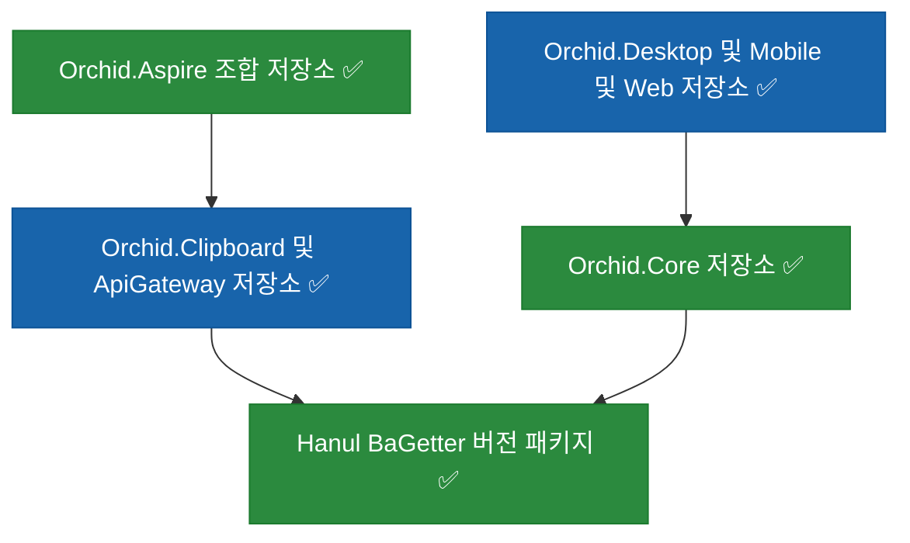
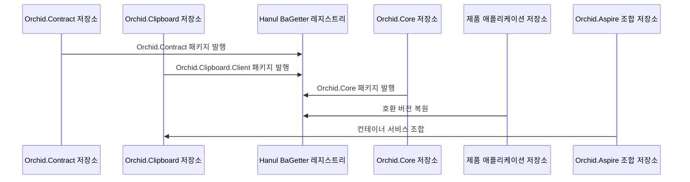

# Orchid 리포지토리 분산 설계

| 상태 | 최종 수정 | 관련 계획 | 구현 상태 |
| --- | --- | --- | --- |
| 채택 | 2026-11-11 | `orchid:261111_refac_orchid-repository-split-migration` | 구현 중 |

## 문서 목적

이 문서는 Orchid 단일 모노레포를 서비스·클라이언트 코어·제품 애플리케이션·조합 저장소의 배포 소유권에 맞춰 `BotanicSoft/Orchid.*` 독립 리포지토리로 분산하는 목표 구조를 정의한다. Git submodule은 저장소 간 코드 의존 수단으로 사용하지 않으며, 공개 계약과 클라이언트 코어는 Hanul BaGetter NuGet 패키지로 교환한다.

## 설계 목표

1. 에이전트 Worktree와 CI가 작업 대상 서비스 또는 제품 애플리케이션만 체크아웃하게 한다.
2. 서비스의 공개 계약과 Client 패키지를 해당 서비스의 배포·버전 책임에 둔다.
3. 공용 계약(`Orchid.Contract`)과 클라이언트 코어(`Orchid.Core`)를 버전된 NuGet 패키지로 발행하여 플랫폼 앱 헤드와 분리한다.
4. 로컬 통합 실행과 시스템 검증은 `Orchid.Aspire` 조합 저장소가 소유한다.

## 시스템 경계

| 경계 | 책임 | 신뢰 수준 |
| --- | --- | --- |
| `Orchid.Aspire` | AppHost 조합, 배포 매니페스트 조합, 시스템 검증 | 제품 내부 |
| `Orchid.Clipboard`, `Orchid.ApiGateway` | 서비스 구현, 공개 Client 패키지, 서비스 테스트 | 제품 내부 |
| `Orchid.Core` | 4대 OS 공용 도메인, AES-256-GCM 암호화, SQLite, SyncEngine | 제품 내부 |
| `Orchid.Desktop`, `Orchid.Mobile`, `Orchid.Web` | 플랫폼별 클라이언트 앱 구현과 해당 테스트 | 제품 내부 |
| Hanul BaGetter 패키지 레지스트리 | 버전된 계약·Client·Core 패키지 전달 | 신뢰된 배포 경계 |

## 구성요소

## 대상 리포지토리 분산 표

| 대상 리포지토리 | 현재 Orchid 경로 | 목표 소유물 | 발행 산출물 |
| --- | --- | --- | --- |
| `Orchid.Contract` | `src/Shared/Contract` | E2EE 페이로드와 공용 계약 모델 | `Orchid.Contract` NuGet |
| `Orchid.Clipboard` | `src/Service/Clipboard`, `src/Core/Sync/Relay` | 클립보드 릴레이 서버와 공개 `Client/src` | Harbor 이미지, `Orchid.Clipboard.Client` NuGet |
| `Orchid.ApiGateway` | `src/Service/ApiGateway` | YARP 리버스 프록시와 라우팅 구성 | Harbor 이미지 |
| `Orchid.Core` | `src/Core` | 4대 OS 공용 도메인, AES-256-GCM 암호화, SQLite, SyncEngine | `Orchid.Core` NuGet |
| `Orchid.Desktop` | `src/Desktop` | Windows·MacCatalyst MAUI Blazor Hybrid 데스크톱 앱 | 데스크톱 설치 패키지 |
| `Orchid.Mobile` | `src/Mobile` | Android·iOS MAUI Blazor Hybrid 모바일 앱 | 스토어 배포 번들 |
| `Orchid.Web` | `src/Web` | Blazor WebAssembly 클립보드 뷰어 웹 앱 | 웹 정적·컨테이너 이미지 |
| `Orchid.Aspire` | `deploy/k8s`, `docs/architecture` | `AddContainer` 기반 Aspire AppHost, 조합 `deploy/k8s`, 교차 검증 | 로컬 오케스트레이션 및 GitOps 조합 |

## 주요 흐름

